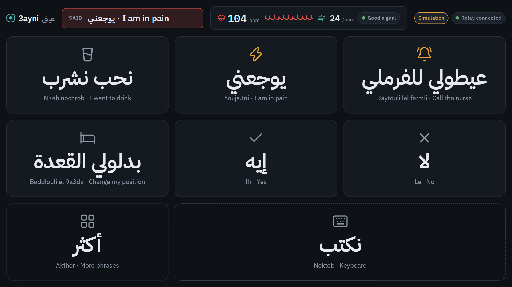
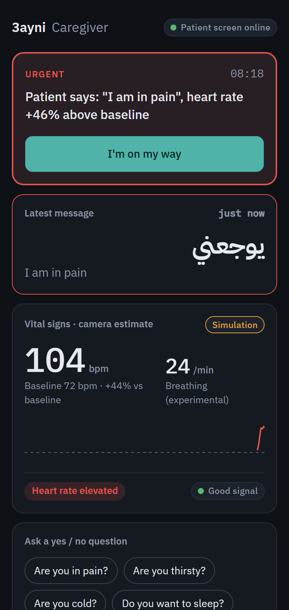
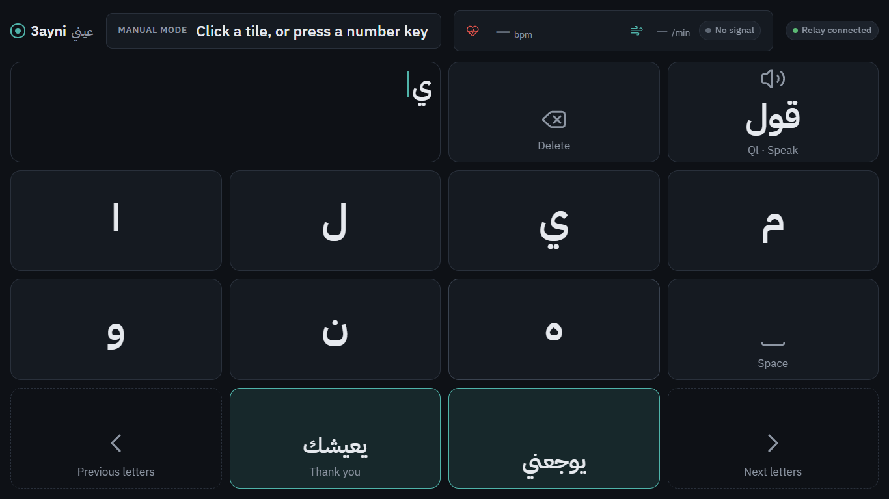

# 3ayni

**عيني**, "my eyes" in Tunisian Arabic.

3ayni lets a patient who cannot speak or move talk with their eyes, and it watches their heart rate through the same laptop camera. When the two together point to trouble, the nurse's phone is told why.

It was built by Eddes Eddes A777 for the IEEE Tech4Health 2.0 hackathon.

<p align="center">
  
  &nbsp;
  
</p>

## Why

After a stroke, with ALS, or on a breathing tube, many patients are fully awake but cannot speak or use their hands. In most hospitals they answer by blinking while someone guesses. Eye-tracking devices exist, but they cost thousands of dinars and only handle the talking. A patient who cannot speak also cannot say that something is wrong.

3ayni needs nothing more than a laptop with a camera, works without internet, and keeps the video on the laptop.

## What the patient can do

- **Say a phrase.** The home screen shows six phrases chosen by the nurse. Looking at one for 1.4 seconds fills a ring, and the laptop says the phrase aloud in Tunisian Arabic. Closing the eyes cancels the choice.
- **Write.** The keyboard shows seven large letters per page, the most used ones first. Two suggestions in the middle complete the word or phrase. When the heart rate is high, the suggestions that ask for help come first.
- **Answer.** When the nurse asks a question, it fills the screen with only Yes and No under it.
- **Rest.** When the patient stops choosing, the screen goes dark and shows a single dot. Looking at the dot for two seconds wakes it. The screen stays awake longer while the heart rate is high.

<p align="center">
  
</p>

## What the nurse sees

The nurse opens 3ayni on a phone by scanning a QR code on the bedside screen. The phone shows each phrase the patient says, the heart rate with a signal-quality grade, and every alert with its reason. From the phone, the nurse can:

- ask yes/no questions;
- choose the six home phrases;
- tap "I'm on my way", which the patient sees.

Alerts follow plain rules that can be read in [`fusion.js`](web/src/patient/fusion.js):

| Situation | What happens |
| --- | --- |
| The heart rate stays 25 % above the patient's own baseline for 45 seconds | The phone shows "heart rate elevated" |
| The patient says "I am in pain" while the heart rate is elevated | Urgent alert, with the phrase and the percentage |
| The heart rate is elevated and the patient has said nothing for two minutes | The bedside screen asks "Are you in pain?" |

## How it works

```
camera frame
   │
   ├── MediaPipe Face Landmarker (478 points, eye shapes, head pose), in the browser
   │
   ├── gaze:  8 eye and head features → personal calibration → smoothing → tile → 1.4 s look
   │
   └── pulse: forehead and cheeks → average skin colour → POS → band-pass → spectrum peak
                                                                              │
                         phrase spoken + sent ─────┐                          │
                                                   ▼                          ▼
                                     alert rules (baseline, elevated, urgent, silent)
                                                   │
                                                   ▼
                                    local relay (WebSocket) → nurse's phone
```

**Gaze.** At the start the patient follows nine dots for about 15 seconds. For each dot the app records eight features: where the iris sits in the eye (across and up and down), how open the eye is, the eye-shape scores, and the head's turn and tilt. It then fits one ridge regression per screen axis. Several details make this hold up with a cheap webcam, or a phone used as a camera below the screen:

- frames taken during a blink or a glance away are dropped;
- the penalty strength is chosen by leaving each dot out and predicting it from the others;
- a stretch per axis brings predictions back out to the corners;
- once the gaze is on a tile, it has to move clearly past the tile's edge before the next tile takes over.

**Heart rate.** Each heartbeat changes the colour of the skin very slightly. The app averages the skin colour of the forehead and both cheeks in every new camera frame. It then uses POS (Wang et al., *IEEE Transactions on Biomedical Engineering*, 2017) to separate the pulse from changes in lighting, and band-passes the result between 39 and 192 bpm. The strongest peak of the spectrum gives the heart rate. Every reading gets a quality grade: a weak signal shows a dash, never an invented number.

**Suggestions.** The phrases are ranked by a small probabilistic model. It weighs what usually follows the last phrase, the time of day, and whether the heart rate is high, and it learns the patient's own habits. It runs instantly and offline, and its choices can be explained.

The full explanation, from the medical background to each formula, is in [docs/HOW-IT-WORKS.md](docs/HOW-IT-WORKS.md).

## Running it

You need Node.js 22 or later, Chrome or Edge, and a webcam.

```powershell
npm install
npm start
```

`npm install` also copies the face model and its runtime into the project, so the app works offline afterwards. `npm start` builds the app and serves it at http://localhost:3000. Set the `PORT` environment variable to use another port.

1. On the laptop, open http://localhost:3000 and start the camera. If you use a phone as the webcam, choose it in the camera list first.
2. Follow the dots with your eyes, keeping your head still.
3. Press `P`, then scan the QR code with a phone on the same Wi-Fi network.

Without a camera, choose "Continue without camera" and use the mouse or the number keys.

| Key | On the bedside screen |
| --- | --- |
| `1`–`9` | Choose a tile |
| `C` | Calibrate again |
| `P` | Show the QR code for the nurse's phone |
| `D` | Operator panel: camera preview, signal quality, calibration error, demo timings |
| `G` | Show where the app thinks you are looking |
| `S` | Simulated heart-rate rise, for demonstrations, labelled "Simulation" on both screens |
| `B` | Use the current heart rate as the baseline |

## Tests and measurements

```powershell
npm test                     # 96 unit tests
npm run evaluate:predictor   # suggestion model against simple baselines
```

The heart-rate tests run on synthetic signals of known frequency, with noise, drift and a lighting flicker inside the heart-rate band. The calibration tests use a simulated person, including one filmed from below.

The suggestion model was evaluated on 3,978 simulated messages it never saw. The right phrase was among its three suggestions 55.7 % of the time, against 37.5 % for a fixed list of the most frequent phrases. These are simulated routines, not patient data. Real numbers need a clinical pilot.

## Privacy and limits

- The video is processed in the browser and never leaves the laptop. Only phrases, alerts and numbers go to the nurse's phone, over the local network.
- The nurse's phone connects only with the random token in the QR code. The server checks the size, the rate and the type of every message.
- Measuring the pulse with a camera needs light on the face and a fairly still head. It is less accurate on darker skin and in dim light. A night version would need an infrared camera.
- 3ayni helps the patient and the nurse, but it is not a medical device and does not replace the hospital's monitors.

## Project layout

```
server/index.js          local relay: pairing, message checks, history for phones that join late
scripts/                 offline asset setup, suggestion model evaluation
web/index.html           bedside screen
web/caregiver.html       nurse's phone
web/src/patient/
  camera.js              webcam and face landmark loop
  gaze/                  features, calibration, ridge regression, smoothing, dwell selection
  vitals/                skin regions, filters, POS heart-rate estimator
  board/                 phrases, screens, keyboard
  predictor.js           phrase suggestions
  fusion.js              alert rules
  sleep.js               when the screen sleeps
web/src/caregiver/       nurse's phone
web/src/shared/          message protocol, relay connection, icons
test/                    unit tests (Vitest)
```

## Team

Eddes Eddes A777: Mohamed Idriss Mokdadi and Ahmed Ammar.
